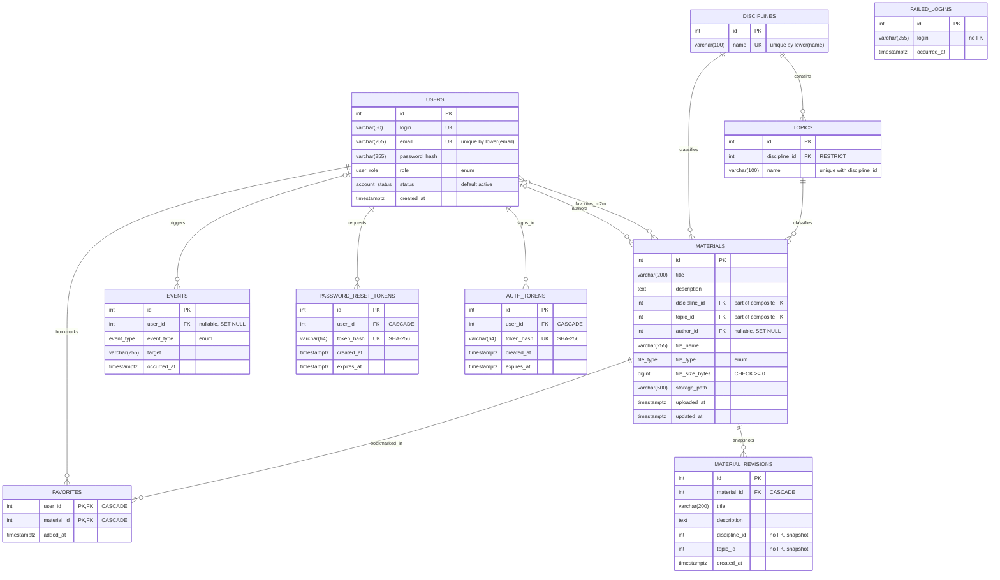

# ER-диаграмма базы данных LMS

Модели: `src/database/models.py`. Миграции: `migrations/versions/`. Схему создаёт только Alembic.

СУБД: PostgreSQL 15+. Схема проектируется по принципу DB-First: диаграмма и таблица
ограничений ниже — источник для моделей SQLAlchemy и миграций Alembic.

## Диаграмма

Обозначения: `PK` — первичный ключ, `FK` — внешний ключ, `UK` — уникальное значение.
Связь `USERS }o--o{ MATERIALS` — это «многие ко многим» (закладки): физически она разложена на две связи 1:N
через таблицу `FAVORITES`, поэтому на диаграмме показаны обе формы. `FAILED_LOGINS` не связана с `USERS`:
попытки бывают и под несуществующими логинами.
Связь `DISCIPLINES → MATERIALS` показана для наглядности: фактически она обеспечивается
составным внешним ключом `(topic_id, discipline_id) → topics(id, discipline_id)`.

## Таблицы и столбцы

Все столбцы `NOT NULL`, кроме `events.user_id` и `materials.author_id`.

| Таблица | Столбец | Тип | Примечание |
|---|---|---|---|
| `users` | `id` | integer | PK, identity |
| | `login` | varchar(50) | |
| | `email` | varchar(255) | |
| | `password_hash` | varchar(255) | хэш, не открытый пароль |
| | `role` | `user_role` | enum |
| | `status` | `account_status` | enum, по умолчанию `active` |
| | `created_at` | timestamptz | по умолчанию `now()` |
| `disciplines` | `id` | integer | PK, identity |
| | `name` | varchar(100) | |
| `topics` | `id` | integer | PK, identity |
| | `discipline_id` | integer | FK → `disciplines.id` |
| | `name` | varchar(100) | |
| `materials` | `id` | integer | PK, identity |
| | `title` | varchar(200) | |
| | `description` | text | |
| | `discipline_id` | integer | часть составного FK |
| | `topic_id` | integer | часть составного FK |
| | `author_id` | integer | FK → `users.id`, **nullable** (автор удалён) |
| | `file_name` | varchar(255) | |
| | `file_type` | `file_type` | enum |
| | `file_size_bytes` | bigint | |
| | `storage_path` | varchar(500) | путь к файлу в хранилище |
| | `uploaded_at` | timestamptz | по умолчанию `now()` |
| | `updated_at` | timestamptz | по умолчанию `now()` |
| `favorites` | `user_id` | integer | часть PK, FK → `users.id` |
| | `material_id` | integer | часть PK, FK → `materials.id` |
| | `added_at` | timestamptz | по умолчанию `now()` |
| `events` | `id` | integer | PK, identity |
| | `user_id` | integer | FK → `users.id`, **nullable** |
| | `event_type` | `event_type` | enum |
| | `target` | varchar(255) | объект события (логин, id материала и т. п.) |
| | `occurred_at` | timestamptz | по умолчанию `now()` |

## Ограничения

| Таблица | Вид | Определение | Зачем |
|---|---|---|---|
| `users` | UNIQUE | `login` | логин не повторяется |
| `users` | UNIQUE INDEX | `lower(email)` | email уникален без учёта регистра (как в `UserRepository.get_by_email`) |
| `disciplines` | UNIQUE INDEX | `lower(name)` | название дисциплины уникально без учёта регистра |
| `topics` | FK | `discipline_id → disciplines(id)`, `ON DELETE RESTRICT` | нельзя удалить дисциплину с темами |
| `topics` | UNIQUE INDEX | `(discipline_id, lower(name))` | тема уникальна внутри дисциплины |
| `topics` | UNIQUE | `(id, discipline_id)` | цель составного FK из `materials` |
| `materials` | FK (составной) | `(topic_id, discipline_id) → topics(id, discipline_id)`, `ON DELETE RESTRICT` | тема материала принадлежит его дисциплине; БД не даёт нарушить это правило |
| `materials` | FK | `author_id → users(id)`, `ON DELETE SET NULL` | материалы остаются после удаления автора и доступны администратору |
| `materials` | CHECK | `file_size_bytes >= 0` | размер файла не отрицательный |
| `favorites` | PK (составной; таблица связи «многие ко многим», `secondary`) | `(user_id, material_id)` | один материал — одна закладка у пользователя |
| `favorites` | FK | `user_id → users(id)`, `ON DELETE CASCADE` | закладки удаляются вместе с пользователем |
| `favorites` | FK | `material_id → materials(id)`, `ON DELETE CASCADE` | закладки удаляются вместе с материалом |
| `events` | FK | `user_id → users(id)`, `ON DELETE SET NULL` | журнал сохраняется после удаления пользователя |

## Индексы

| Таблица | Индекс | Для чего |
|---|---|---|
| `materials` | `(discipline_id, topic_id)` | фильтрация каталога по дисциплине и теме |
| `materials` | `author_id` | материалы автора, проверка FK при удалении пользователя |
| `materials` | `uploaded_at` | сортировка по дате загрузки |
| `materials` | `title` | сортировка по названию |
| `materials` | `ix_materials_search_vector`: GIN по `to_tsvector('russian', title \|\| ' ' \|\| description)` | полнотекстовый поиск с морфологией (миграция `29a9fdd081e4`, создан вручную: Alembic не сравнивает индексы по выражениям) |
| `favorites` | `material_id` | проверка FK и каскад при удалении материала (PK уже покрывает `user_id`) |
| `events` | `occurred_at` | вывод журнала по времени |
| `events` | `user_id` | события пользователя, проверка FK |

## Перечисления (enum)

Значения совпадают с `StrEnum` из `src/domain/enums.py`.

| Тип PostgreSQL | Значения |
|---|---|
| `user_role` | `student`, `teacher`, `admin` |
| `account_status` | `active`, `blocked` |
| `file_type` | `pdf`, `docx`, `pptx`, `xlsx`, `jpg`, `png` |
| `event_type` | 21 значение из `EventType` (`user_logged_in`, `material_created`, `favorite_added`, …) |

## Принятые решения

- Удаление автора: `materials.author_id` — `ON DELETE SET NULL`. Материалы не теряются и
  остаются доступными; редактировать и удалять такой материал может только администратор
  (преподаватель не совпадает с пустым автором). В интерфейсе вместо автора показывается
  «автор удалён».
- `users.created_at` и `materials.updated_at` добавлены сверх доменных моделей.
- Закладки (`favorites`) — таблица связи «многие ко многим» между `users` и `materials`
  (в SQLAlchemy `Table` + `relationship(secondary=...)` с `back_populates` с обеих сторон:
  `UserEntity.favorite_materials` и `MaterialEntity.favorited_by`).
- Правила удаления лежат в БД (`ON DELETE`); у связей в ORM стоят согласованные `passive_deletes`.
- Названия и email уникальны без учёта регистра через `lower(...)`: база должна иметь UTF-8 локаль
  (в локали `C` кириллица не приводится к нижнему регистру). Приложение проверяет это при старте.
- Гость в журнале и удалённый пользователь одинаково дают `events.user_id = NULL`.

## Таблицы состояния приложения (миграция `825037384a42`)

| Таблица | Назначение | Столбцы | Связи и ограничения |
|---|---|---|---|
| `password_reset_tokens` | коды восстановления пароля | `id`, `user_id`, `token_hash` varchar(64), `created_at`, `expires_at` | `user_id → users(id)` `CASCADE`; `token_hash` уникален (хранится SHA-256, не сам код); индексы по `user_id`, `expires_at` |
| `failed_logins` | неудачные попытки входа | `id`, `login` varchar(255), `occurred_at` | без FK: попытки бывают и под несуществующими логинами; индекс по `login`; число строк логина — попытки подряд |
| `material_revisions` | снимки материала для отмены правок | `id`, `material_id`, `title`, `description`, `discipline_id`, `topic_id`, `created_at` | `material_id → materials(id)` `CASCADE`; `discipline_id`, `topic_id` без FK (значения на момент снимка); хранится не более 20 на материал |

## Токены доступа к REST API (миграция `4a8c6f486877`)

| Таблица | Назначение | Столбцы | Связи и ограничения |
|---|---|---|---|
| `auth_tokens` | токены, выданные при входе через `POST /api/auth/login` | `id`, `user_id`, `token_hash` varchar(64), `created_at`, `expires_at` | `user_id → users(id)` `CASCADE` (при удалении пользователя его токены исчезают); `token_hash` уникален (хранится SHA-256, не сам токен); индексы по `user_id`, `expires_at` |

Токен можно отозвать (`POST /api/auth/logout` удаляет строку) и он истекает сам (по умолчанию через 12 часов,
`AUTH_TOKEN_TTL_HOURS` в `configs/config.py`). Состояние лежит в БД, поэтому одинаково видно всем воркерам сервера.
